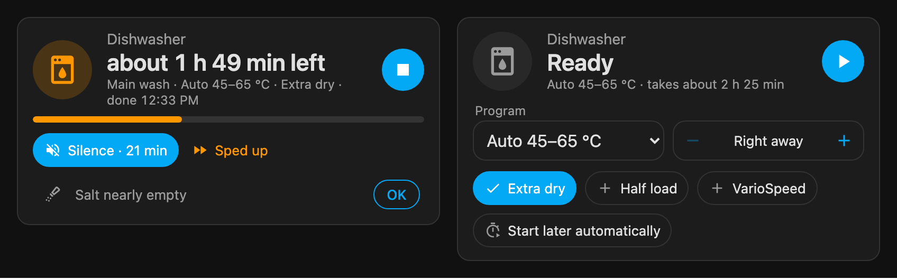
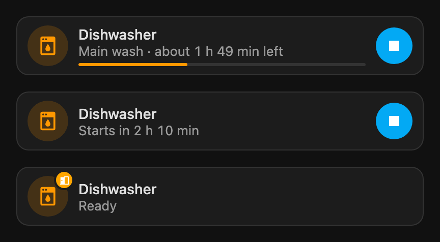

# hcpy Dishwasher Card

A Lovelace card for Bosch and Siemens dishwashers that talk to Home Assistant **locally**, through [hcpy](https://github.com/hcpy2-0/hcpy) (the HomeConnect2MQTT app) and MQTT discovery – no Home Connect cloud needed. Unofficial; not affiliated with or endorsed by BSH, Bosch, Siemens or Home Connect, product names are trademarks of their respective owners.



## The card

One card for your dishwasher: what it is doing right now, how long it still takes and what you can change at that moment. hcpy hands over raw values like `Auto2` or `MainWash`; the card shows them as readable text instead. It stays calm while nothing needs attention and speaks up when the dishwasher asks for something.

Colors, fonts and texts follow your Home Assistant theme, your profile's primary and accent color and your language (English and German included).

**Row (`mode: row`):** the same in one tile-sized row, made for a "what's running" section on a phone. Tapping it opens the more-info dialog or a pop-up of your choice.



## Requirements

- Home Assistant with MQTT and [hcpy](https://github.com/hcpy2-0/hcpy) (HomeConnect2MQTT) with Home Assistant discovery switched on (`HCPY_HA_DISCOVERY`).
- Hints work with `HCPY_EVENTS_AS_SENSORS` on or off.
- The card finds the dishwasher and its entities by itself, from the keys hcpy puts into their unique IDs, so renaming the entities does not break it. Entities your dishwasher does not have are left out. With several hcpy dishwashers, pick one with `device_id`.

## Installation

**From the catalog (review pending):** the card is submitted to the default catalog of the Marketplace / HACS. Once it is accepted, search for *hcpy Dishwasher Card* there and install it. Until then, add it as a custom repository:

**Home Assistant 2026.11 and later (Marketplace):**

1. Add the repository (*Add from link*, `https://github.com/KindOfNerdy/hcpy-dishwasher-card`):

   [](https://my.home-assistant.io/redirect/marketplace_repositories/)

2. Install the card:

   [](https://my.home-assistant.io/redirect/marketplace_repository/?owner=KindOfNerdy&repository=hcpy-dishwasher-card&category=plugin)

**Earlier versions:** add the repository in HACS as a custom repository of type *Dashboard*, then download the card.

[](https://my.home-assistant.io/redirect/hacs_repository/?owner=KindOfNerdy&repository=hcpy-dishwasher-card&category=plugin)

## Usage

Add "Dishwasher (hcpy)" from the card picker and set it up in the visual editor, or use YAML:

```yaml
type: custom:hcpy-dishwasher-card
```

## Options

| Option | Default | Description |
|---|---|---|
| `mode` | `full` | `full` or `row` (see above) |
| `name` | device name | Name shown in the card |
| `device_id` | found by itself | The dishwasher to show, if hcpy has more than one (the visual editor lets you pick it) |
| `starter_entity` | – | An extra `input_boolean` or `switch` shown next to the options while no program runs, e.g. for an automation of your own that starts the dishwasher later |
| `starter_name` | entity name | Name shown for that switch |
| `starter_icon` | entity icon | Icon shown for that switch |
| `preselect_entity` | – | Text helper for the preselection when switched on (see below); shows that part in the settings fold |
| `start_options` | – | Options switched on before every start and after choosing another program, if the program allows them: `extradry`, `halfload`, `variospeedplus` |
| `hide` | – | Parts to hide: `options`, `program` (program and delayed start), `hints`, `door`, `care`, `settings`, `controls` (all buttons, drop-downs and chips – a display only) |
| `tap_action`, `hold_action` | more-info, – | Row only: what tapping or holding the row does (standard Home Assistant actions) |

A row that opens a pop-up with the full card:

```yaml
type: custom:hcpy-dishwasher-card
mode: row
tap_action:
  action: navigate
  navigation_path: "#dishwasher"
```

## Start when nobody is home

The card shows what is set on the dishwasher – program, options and delayed start. With a toggle helper and the blueprint below, the dishwasher starts with exactly these settings as soon as everyone has left. Switching the helper off before then cancels the start.

1. Create a toggle helper, for example "Start dishwasher when nobody is home":

   [](https://my.home-assistant.io/redirect/helpers/)

2. Import the blueprint:

   [](https://my.home-assistant.io/redirect/blueprint_import/?blueprint_url=https%3A%2F%2Fgithub.com%2FKindOfNerdy%2Fhcpy-dishwasher-card%2Fblob%2Fmain%2Fblueprints%2Fautomation%2Fhcpy_dishwasher_start_when_away.yaml)

3. Create an automation from it: pick the helper, who counts as being home (a person, a group, the home zone …) and the dishwasher entities from hcpy. Optionally add notifications; the text for each step is in `message`.
4. Show the helper in the card:

   ```yaml
   type: custom:hcpy-dishwasher-card
   starter_entity: input_boolean.start_dishwasher_when_nobody_is_home
   starter_name: Start when nobody is home
   ```

The dishwasher needs remote start allowed and a closed door. If something is missing when it is time to start, the automation says why instead of failing silently.

## Preselect when switched on

Want the same program and options every time the dishwasher is switched on – at the machine or from the card? Keep them in a text helper, set them in the card and let a second blueprint apply them.

1. Create a text helper (maximum length 255), for example "Dishwasher preselection":

   [](https://my.home-assistant.io/redirect/helpers/)

2. Import the blueprint:

   [](https://my.home-assistant.io/redirect/blueprint_import/?blueprint_url=https%3A%2F%2Fgithub.com%2FKindOfNerdy%2Fhcpy-dishwasher-card%2Fblob%2Fmain%2Fblueprints%2Fautomation%2Fhcpy_dishwasher_preselect_when_on.yaml)

3. Create an automation from it: pick the helper and the dishwasher entities from hcpy. Optionally skip it while somebody is away, and give it the helper of "start when nobody is home" so it leaves an armed start alone.
4. Add the helper to the card; the settings fold then has a "Preselection when switched on" part:

   ```yaml
   type: custom:hcpy-dishwasher-card
   preselect_entity: input_text.dishwasher_preselection
   ```

## Thanks

All of this only works because [hcpy](https://github.com/hcpy2-0/hcpy) talks to the dishwasher locally.

## Support

If this saves you time, you can [buy me a coffee on Ko-fi](https://ko-fi.com/kindofnerdy) ☕
